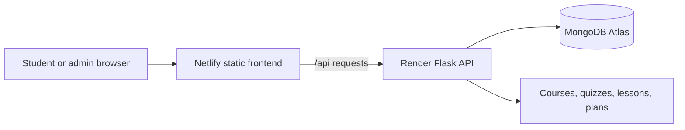

<div align="center">

# ✦ Nebula 👾

### Learn in your own orbit.

An adaptive B.Tech learning workspace that turns quiz results into a clear, manageable next step.

[](https://www.python.org/)
[](https://flask.palletsprojects.com/)
[](https://www.mongodb.com/atlas)
[](https://www.netlify.com/)
[](https://render.com/)

[Open Nebula](https://nebula-orbit.netlify.app) · [API health](https://nebula-orbit.onrender.com/api/health) · [Student system design](STUDENT_SYSTEM_DESIGN.md) · [Admin system design](ADMIN_SYSTEM_DESIGN.md)

</div>

---

## Contents

- [About](#about)
- [What it does](#what-it-does)
- [How personalization works](#how-personalization-works)
- [Technology and architecture](#technology-and-architecture)
- [Run locally](#run-locally)
- [Dataset and model workflow](#dataset-and-model-workflow)
- [Deployment](#deployment)
- [API reference](#api-reference)
- [Project structure](#project-structure)
- [Run the backend acceptance suite](#run-the-backend-acceptance-suite)
- [Security notes](#security-notes)
- [Current scope](#current-scope)

## About

Nebula is an AI-assisted learning MVP for students who want a more focused way to study B.Tech subjects. Students can explore a course, take a topic-based quiz, review their score, and use a personalized study plan to decide what to work on next. Administrators maintain the learning content and manage student access.

The product keeps recommendations explainable: a student's own quiz history and the curriculum prerequisite graph drive the study plan. The included machine-learning score estimator is experimental and is **not** treated as a reliable student-facing prediction.

## What it does

### Student workspace

- Sign up and sign in with a student account.
- Choose a learning focus, degree/level, and daily study-time budget.
- Set available study days and preferred session length in the profile.
- Explore the B.Tech course catalog and enroll in courses.
- Read published in-app pilot lessons where available; find topic-specific video resources through YouTube search links.
- Take quizzes, see answer explanations after submission, and review saved attempts.
- Track quiz averages, topic mastery, completed lessons, and study streaks.
- Generate a study plan that prioritizes quiz performance and course prerequisites.

### Administrator workspace

- Create, edit, publish, and remove courses and quizzes.
- Draft, publish, edit, and remove lessons linked to course topics.
- Review student account status and high-level activity.
- Suspend and restore student access.

Administrator registration requires the private `ADMIN_SIGNUP_KEY` configured on the backend. It is never included in frontend code or this README.

## How personalization works

1. Quiz attempts are saved to the student's account.
2. Topic-level performance highlights areas for more practice.
3. Course prerequisites help order foundational work before dependent topics.
4. The study planner schedules focused sessions around the student's selected days, session length, and daily time budget.
5. New quiz results can refresh the plan and recommendations.

These recommendations are rule-based and grounded in the student's app activity. They are guidance for study planning, not a guarantee of exam results.

### Experimental ML model

The repository includes a model that estimates a learner's next assessment score from historical assessment data. It uses a chronological train/validation/test split. In the current evaluation, proficiency-band accuracy equals the majority-class baseline, and the model's test R² is negative. The backend therefore does not treat its output as a dependable personalized forecast; score-based rules remain the active planning approach.

See the evaluation details in [`backend/performance_model_metrics.json`](backend/performance_model_metrics.json) and data limitations in [`backend/DATASET_NOTES.md`](backend/DATASET_NOTES.md). Do not tune against the held-out test period.

## Technology and architecture

| Layer | Implementation |
|---|---|
| Frontend | Static HTML, CSS, and JavaScript |
| API and authentication | Python, Flask, Flask-JWT-Extended |
| Database | MongoDB Atlas or local MongoDB |
| Model workflow | pandas-compatible CSV input, scikit-learn |
| Production API server | Gunicorn in Docker |
| Hosting | Netlify frontend, Render API, MongoDB Atlas database |



The frontend sends requests to `/api`. Netlify routes those requests to the Render service, so the browser uses one site origin. The free Render instance may sleep when inactive; its first request after a quiet period can take longer.

## Run locally

### MongoDB-backed app

You need Python 3.10+ and either a running local MongoDB server or an Atlas connection string.

1. Create a private environment file:

   ```powershell
   Copy-Item backend/.env.example backend/.env
   ```

2. Edit `backend/.env` locally. Set `MONGODB_URI`, `MONGODB_DB`, `JWT_SECRET_KEY`, `ADMIN_SIGNUP_KEY`, and `FRONTEND_ORIGIN` for your setup. Use private random secrets; do not paste them into chat or commit the file.

3. Install dependencies and start the API from the `backend` directory:

   ```powershell
   cd backend
   python -m venv .venv
   .\.venv\Scripts\Activate.ps1
   pip install -r requirements.txt
   python app.py
   ```

4. Open [http://127.0.0.1:5000](http://127.0.0.1:5000). Check API and database connectivity at [http://127.0.0.1:5000/api/health](http://127.0.0.1:5000/api/health).

On macOS/Linux, activate the virtual environment with `source .venv/bin/activate`.

### Local demo mode

For a local demo backed by the `.demo_data.json` snapshot, use Windows PowerShell from the repository root:

```powershell
powershell -ExecutionPolicy Bypass -File .\backend\start-demo.ps1
```

Demo mode is for one local developer process, not shared student accounts. Keep the snapshot private and backed up; it may contain personal demo data.

## Dataset and model workflow

The curriculum data and assessment history are in `backend/`:

| File | Purpose |
|---|---|
| `courses.csv` | Course catalog |
| `topics.csv` | Topic catalog and study metadata |
| `topic_prerequisite.csv` | Relationships used to sequence foundational topics |
| `student_interaction.csv` | Historical assessment records for analysis/model evaluation |

To import or sync the curriculum into the configured MongoDB database, run from `backend/`:

```powershell
python import_dataset.py
```

Historical assessment rows are imported only when a private `DATASET_HASH_SALT` is configured. The importer omits student names and pseudonymizes student and interaction IDs. Imported historical identities are not connected to app login accounts.

To retrain the experimental score estimator after changing the data:

```powershell
python train_performance_model.py
```

Review the held-out metrics before using a new artifact. A stronger model needs genuinely predictive features and future learning outcomes; more rows alone do not guarantee better accuracy. Dataset definitions, privacy handling, and limitations are documented in [`backend/DATASET_NOTES.md`](backend/DATASET_NOTES.md).

## Deployment

### Frontend — Netlify

- Connect the GitHub repository and deploy the `main` branch.
- Set the publish directory to `frontend`; no build command is required.
- Keep the root `netlify.toml`: it serves `/assets/*`, proxies `/api/*` to Render, and routes frontend paths to `index.html`.
- Configure `FRONTEND_ORIGIN` on Render to match the deployed site origin, without a trailing slash.

### Backend — Render

- Create a Docker web service from the repository root using the root `Dockerfile`.
- Configure the required environment variables in Render's Environment settings.
- Set the health-check path to `/api/health`.
- Add Render's documented outbound IP ranges to the Atlas Network Access list. Avoid broad `0.0.0.0/0` access for a production database.

### MongoDB Atlas

- Use an application database user with only the permissions required by Nebula.
- Store the connection string as the `MONGODB_URI` secret in Render; set `MONGODB_DB` to the intended database name.
- Confirm Atlas network access permits the Render service to connect.
- Configure backups and retention before onboarding real students.

### Backend environment variables

Set these in the deployment provider's private environment settings. The values belong there, not in source control or README:

| Variable | Purpose |
|---|---|
| `NEBULA_ENV` | Use `production` for the hosted service |
| `NEBULA_DEMO_MODE` | Keep `false` when using MongoDB |
| `MONGODB_URI` | Private MongoDB connection string |
| `MONGODB_DB` | MongoDB database name |
| `JWT_SECRET_KEY` | Private token-signing secret |
| `ADMIN_SIGNUP_KEY` | Private admin invitation key |
| `FRONTEND_ORIGIN` | Exact deployed frontend origin, without trailing slash |

## API reference

Protected routes require `Authorization: Bearer <access_token>`. Admin-only routes additionally require an administrator account.

| Area | Endpoints |
|---|---|
| Health | `GET /api/health` |
| Accounts | `POST /api/auth/register`, `POST /api/auth/login`, `GET /api/auth/me`, `PATCH /api/auth/profile` |
| Courses | `GET /api/courses`, `POST /api/courses`, `PUT/DELETE /api/courses/:course_id` |
| Enrollment and topics | `GET /api/enrollments`, `POST/DELETE /api/enrollments/:course_id`, `GET /api/courses/:course_id/topics` |
| Lessons | `GET /api/courses/:course_id/lessons`, `GET/POST /api/admin/lessons`, `PUT/DELETE /api/admin/lessons/:id`, `POST /api/lessons/:id/complete` |
| Quizzes | `GET /api/quizzes`, `GET /api/quizzes/:id`, `POST /api/quizzes`, `PUT/DELETE /api/quizzes/:id`, `POST /api/quizzes/:id/submit` |
| Student learning | `GET /api/progress`, `GET /api/study-plan`, `POST /api/study-plan/generate`, `GET /api/recommendations` |
| Admin | `GET /api/admin/overview`, `GET /api/admin/students`, `PATCH /api/admin/students/:id/status` |

Quiz answer keys are not sent with the student quiz. Grading feedback is returned after submission. Admin student views contain profile preferences and aggregate activity, not password hashes or answer selections. Draft lessons are only available to admins; published lessons are available to students.

## Project structure

```text
.
├── backend/                 Flask API, CSV data, model workflow, and tests
│   ├── app.py               API routes, authentication, study planner
│   ├── tests/               Backend acceptance and regression tests
│   ├── *.csv                Curriculum and historical assessment data
│   ├── import_dataset.py    MongoDB curriculum/history importer
│   └── train_performance_model.py
├── frontend/                Static HTML, JavaScript, and CSS
├── Dockerfile               Render/Gunicorn container setup
├── netlify.toml             Netlify publishing, API proxy, and SPA routes
├── STUDENT_SYSTEM_DESIGN.md  Student experience and flow
├── ADMIN_SYSTEM_DESIGN.md   Admin experience and flow
└── MVP_READINESS.md         Current MVP checklist and launch considerations
```

## Run the backend acceptance suite

From `backend/`, install the development dependencies and run the isolated API acceptance tests:

```powershell
pip install -r requirements-dev.txt
python -m unittest discover -s tests -v
```

The suite uses `mongomock` and does not write test users or attempts to your Atlas database.

## Security notes

- `backend/.env` is private local configuration and is ignored by Git.
- Never commit database URIs, passwords, JWT secrets, admin signup keys, or dataset salts.
- Use provider-managed secret settings for Render and keep access limited to project maintainers.
- Rotate any credential that was exposed in a screenshot, terminal capture, chat, or Git history.
- Do not put real student data in public issues, screenshots, or sample files.

## Current scope

- The catalog contains B.Tech learning subjects and topic/prerequisite metadata from the supplied CSVs.
- In-app lesson content is a small pilot set for selected subjects; other topics can use generated YouTube search links until reviewed lessons are published.
- The baseline quizzes are short diagnostic checks, not complete GATE, semester-exam, or placement-interview preparation material. Expand and review the question bank before using it for formal assessment.
- Rule-based study planning is active. The ML score estimator remains experimental and is not a promise of student performance.

For the detailed launch checklist and verification status, see [`MVP_READINESS.md`](MVP_READINESS.md).
