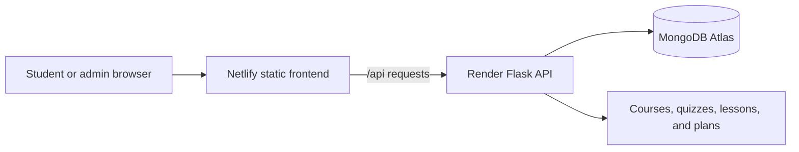

<div align="center">

# ✦ Nebula

### Learn in your own orbit.

**An adaptive learning workspace for B.Tech and BCA students.** Nebula turns a student's quiz history into transparent topic feedback and a practical study plan. The current planner uses score rules and curriculum prerequisites; the experimental ML score estimator is evaluated offline and is not used to make student-facing predictions.

[](https://www.python.org/)
[](https://flask.palletsprojects.com/)
[](https://www.mongodb.com/atlas)
[](https://www.netlify.com/)
[](https://render.com/)

[Open Nebula](https://nebula-orbit.netlify.app) · [API health](https://nebula-orbit.onrender.com/api/health) · [Student system design](STUDENT_SYSTEM_DESIGN.md) · [Admin system design](ADMIN_SYSTEM_DESIGN.md)

</div>

---

## At a glance

| Area | Current repository coverage |
|---|---|
| Learning tracks | 35 B.Tech branches/specialization and 1 BCA track |
| Curriculum sources | 522 track-to-course rows across 147 branch-outline course codes, plus 25 shared catalog courses |
| Practice bank | 172 quiz sets and 2,595 explained questions in CSV |
| Topic practice coverage | 860 course-topic pairs across 172 courses; 855 distinct topic labels |
| Topic concept guides | 860 original guide drafts, one per course-topic pair, with further-reading references |
| In-app lessons | 10 pilot lessons across DSA, Python, DBMS, Computer Networks, and Operating Systems |
| Personalization | Transparent score thresholds, learner history, prerequisites, and study-time preferences |
| Weekly planning | Seven-day schedule with daily check-offs, completion progress, and unscheduled overflow |
| Gamification | 15 server-tracked achievements, XP/levels, and downloadable SVG/PNG badge art |
| ML status | Experimental next-score model; currently below the evidence gate and hidden from student forecasts |

Counts describe source-controlled project data. The expanded CSV question bank is not automatically present in a hosted MongoDB database: seed and verify the target database before claiming the hosted app has these counts. The course outlines are common references, not complete semester-by-semester curricula for every institution. All 2,595 authored question records are pending external instructor review.

The topic guide source is `backend/data/topic_concept_guides.csv`; it contains one row for each of the 860 course-topic pairs represented in the question bank. Guide prose is original Nebula-authored draft content, not copied from GeeksforGeeks or Wikipedia. Reference columns point to official documentation where available and topic search pages for further reading. Individual facts and course-specific fit still need instructor review; the guides are not a substitute for a university's prescribed syllabus.

## What Nebula does

### Student workspace

- Create an account and select a supported B.Tech branch/specialization or BCA track.
- Explore the track's available course catalog and enroll in courses.
- Take a topic-linked quiz and see the score, correct answers, and explanations after submission.
- Review topic mastery and saved quiz attempts. A topic is labelled weak only after at least 3 distinct questions; smaller samples are marked preliminary.
- Read a published in-app lesson when one is available, or open a topic-specific YouTube search for other topics. These are generated search links, not a YouTube API integration. Students can manually mark each external video as watched; Nebula cannot verify playback or watch time.
- Generate a study plan that prioritizes weak topics in enrolled courses, prerequisite topics, available study days, and the student's time budget. Each session explains why it was selected.
- Follow a seven-day plan, check off individual study days/sessions, and see completion progress. Sessions that do not fit the selected days remain visible as unscheduled next steps.
- Open an interactive 3D concept map from a study session. It lays out recorded prerequisite topics, shows the learner's quiz signal, and presents an original guide for each of the 860 course-topic pairs (core idea, key concepts, components, mechanism, example, uses, trade-offs, and a self-check). It also links matching published Nebula lessons/quizzes and provides further-reading search links.
- Choose adaptive, basic, medium, or advanced learning depth. This setting adjusts YouTube search wording; in-app lessons remain at their authored level and quiz difficulty is not automatically adapted.
- Mark study sessions and in-app lessons complete. When a suitable later quiz exists, compare its topic score with the earlier baseline.
- Review quiz averages, topic progress, completed sessions, and study streaks. Quiz answer review shows the selected answer, correct answer, and explanation.
- Earn 15 achievements through learning activity, gain XP/levels, and download unlocked badge artwork as SVG or PNG.

After every topic video in a course has been manually marked watched, Nebula schedules an in-app course revision check-in for 7 days later. It is shown in the app when due; video completion is self-reported, and no YouTube playback tracking or external push/email delivery is claimed. A follow-up quiz can show a later score difference, but that difference alone does not prove the video or plan caused improvement.

### Administrator workspace

- Create, edit, publish, and remove courses and quizzes.
- Draft, publish, edit, and remove lessons linked to course topics.
- Review student account status and high-level activity, and suspend or restore access.
- View small pilot signals such as return activity, plan completion, and eligible paired quiz results. These are descriptive product metrics, not proof of learning effectiveness.

Administrator registration uses the private `ADMIN_SIGNUP_KEY` configured on the backend. Keep its value in environment settings; never place secrets in this README or frontend code.

## How the study plan adapts

1. The student completes a quiz; Nebula saves the attempt to that account and shows answer-by-answer review.
2. Scores across distinct questions provide topic-level signals. Small samples stay preliminary.
3. Low-scoring topics, course prerequisites, and enrollment guide what appears next.
4. A seven-day plan fits sessions around the student's selected study days, preferred session length, and daily study-time budget. The student can check off completed days/sessions; these check-offs are self-reported.
5. The topic map lays out any prerequisite links present in Nebula's curriculum and exposes its matching published lesson and quiz resources. Topic explanations themselves must exist as Nebula lesson content; the visualization does not generate them.
6. After a completed study session, a later quiz on the same course and topic may be paired with its earlier baseline. At least 3 distinct questions are required on both sides for the score-change signal.
7. New quiz activity can refresh study priorities and schedule spaced review.

The planner is rule-based and explainable. Its guidance is not a guarantee of exam results.

## ML model: experimental, not powering recommendations

The repository includes a scikit-learn model that estimates a learner's next assessment score from earlier assessment history. It uses a chronological train/validation/test split to avoid training on future attempts. The checked-in evaluation artifact reports:

- **Model:** `RandomForestRegressor`, selected from the candidates using validation data.
- **Evaluation data:** 25,000 historical/synthetic assessment rows, grouped by assessment date for a 70/10/20 split.
- **Held-out score MAE:** 14.166 points, compared with 14.159 for the global-mean baseline.
- **Proficiency-band accuracy:** 59.13%, equal to the majority-class baseline.
- **R²:** −0.0012.

These results show no meaningful predictive lift. The backend therefore disables student-facing score forecasts; quiz-score rules and prerequisites remain the active study-planning logic. Do not describe Nebula as an AI-powered tutor or claim that its ML model improves learning outcomes. Better evidence needs real, repeated student assessments and recorded learning outcomes after recommendations, followed by a fresh untouched evaluation.

See [`backend/models/performance_model_metrics.json`](backend/models/performance_model_metrics.json), [`backend/docs/DATASET_NOTES.md`](backend/docs/DATASET_NOTES.md), and the model trainer at [`backend/scripts/train_performance_model.py`](backend/scripts/train_performance_model.py). Do not tune against the held-out test period.

### Latest live-data candidate evaluation

The separate live evaluator reads quiz attempts from MongoDB and writes only a local candidate artifact and aggregate metrics; it does not update MongoDB or replace the production model. The latest recorded run (20 Nov 2026) used 718 earlier rows for training/selection, 561 rows from 18 Nov for validation, and 220 later rows from 19 Nov onward for a chronological test. Its `RandomForestRegressor` candidate reported:

| Metric | Candidate result | Comparison |
|---|---:|---|
| Test MAE | 21.863 points | Previous-topic-mean baseline: 20.872 (better) |
| Test RMSE | 38.646 points | — |
| R² | 0.1608 | Describes this held-out sample; not evidence of useful lift by itself |
| Proficiency-band accuracy | 73.18% | Majority-band baseline: 73.64% (better) |
| Balanced accuracy / macro F1 | 56.81% / 51.26% | — |

This run is **not eligible for student-facing use**: the candidate did not beat the comparison baselines, and 633 of 938 topic rows used evaluation-only topic IDs rather than the 305 official catalog topic IDs. The model artifact is a local experiment, not the deployed predictor. The read-only workflows are [`backend/scripts/evaluate_live_assessments.py`](backend/scripts/evaluate_live_assessments.py) and [`backend/scripts/evaluate_live_grouped_cv.py`](backend/scripts/evaluate_live_grouped_cv.py); they require access to a configured database and private environment settings. Metrics may change when the evaluation is rerun against new data.

## Technology and architecture

| Layer | Implementation |
|---|---|
| Frontend | Static HTML, CSS, and JavaScript |
| Visual identity | Nebula SVG logo and an ambient canvas-based Ghost Fibers background |
| API and authentication | Python, Flask, Flask-JWT-Extended |
| Database | MongoDB Atlas or local MongoDB |
| Offline model workflow | scikit-learn, CSV assessment history |
| Production API server | Gunicorn in Docker |
| Hosting configuration | Netlify frontend, Render API, MongoDB Atlas database |



The browser sends requests to `/api` on the same site origin. Netlify forwards API requests to the Render service, which reads and writes MongoDB. A free hosting plan may spin down after inactivity, making the first request slower. Flask also serves the frontend from `/` and `/assets` when running locally or in the Docker service.

## Curriculum and question bank

Curriculum source files are grouped in `backend/data/`:

| File | Purpose |
|---|---|
| `backend/data/curriculum_tracks.csv` | 35 B.Tech branch/specialization tracks and the BCA track |
| `backend/data/courses.csv`, `backend/data/topics.csv` | Shared course catalog and topic metadata |
| `backend/data/course_tracks.csv` | Assigns shared catalog courses to applicable tracks |
| `backend/data/branch_curriculum.csv` | Track-specific course and topic outlines |
| `backend/data/curriculum_track_parents.csv` | Explicit inheritance between related specializations |
| `backend/data/topic_prerequisite.csv` | Prerequisite relationships used by the planner |
| `backend/data/practice_question_bank.csv` | Question text, choices, answer keys, explanations, and review fields |
| `backend/data/student_interaction.csv` | Historical/synthetic assessment data used for offline model analysis |

The 35 B.Tech options and BCA track follow a common reference outline. The catalog is not mapped to a specific university's semesters, credits, or electives, and it is not a complete GATE, placement, or degree-exam course. See [`backend/docs/CURRICULUM_SOURCES.md`](backend/docs/CURRICULUM_SOURCES.md) for source scope and limitations.

The CSV question bank has 172 quiz sets, each with at least 15 questions; 860 listed course-topic pairs have at least 3 distinct questions. These are Nebula-authored starter questions, not copied question-bank material. Structural and course/topic-linkage checks do not replace subject-matter review: every question is still pending external instructor review. Treat these as formative practice, not certified exam material or full-length mocks. Lessons are currently limited to the five-subject pilot listed above.

The app's quiz catalog is stored in MongoDB. Import and seed commands modify the configured database, so first confirm `MONGODB_URI` and `MONGODB_DB` point to the intended environment. The repository readiness checklist records live seeding and browser verification as outstanding; verify the hosted database before assuming the expanded question bank is visible online.

## Run locally

You need Python 3.10+ and either a local MongoDB server or a MongoDB Atlas connection string.

1. Create a private backend environment file:

   ```powershell
   Copy-Item backend/.env.example backend/.env
   ```

2. Set `MONGODB_URI`, `MONGODB_DB`, `JWT_SECRET_KEY`, `ADMIN_SIGNUP_KEY`, and `FRONTEND_ORIGIN` in `backend/.env`. Use private random secrets. Do not paste them into chat or commit the file.

3. Install backend dependencies and start the API:

   ```powershell
   cd backend
   python -m venv .venv
   .\.venv\Scripts\Activate.ps1
   pip install -r requirements.txt
   python app.py
   ```

4. Confirm the API and database connection at [http://127.0.0.1:5000/api/health](http://127.0.0.1:5000/api/health).

Open [http://127.0.0.1:5000](http://127.0.0.1:5000) to use the UI and API together. Flask serves the static frontend and `/api` from the same origin. A separate static server such as `python -m http.server` does not proxy API calls; if you choose to run the frontend separately, configure a development proxy to the Flask API. The deployed Netlify configuration provides the `/api` proxy.

For macOS/Linux, activate the virtual environment with `source .venv/bin/activate` and use `python app.py` from `backend/`.

### Optional local demo mode

From the repository root, run:

```powershell
powershell -ExecutionPolicy Bypass -File .\backend\scripts\start-demo.ps1
```

Demo mode uses an in-memory Mongo mock and may restore or create the ignored `backend/.local/demo_data.json` snapshot. It is for one local demonstration, not multiple users or production. Keep any snapshot private; it may contain personal demo data.

## Import and seed curriculum content

Run these only after verifying that the environment points to the intended MongoDB database. From `backend/`:

```powershell
python scripts/import_dataset.py
python scripts/seed_learning_content.py
```

The first command syncs the CSV curriculum. The second adds source-controlled pilot lessons and quizzes. The seeder preserves admin-edited quizzes and only expands unchanged seeded content under its signature checks. Re-run safely only after confirming the target database; then verify course, quiz, and lesson counts in the app.

Historical assessment rows are imported only when a private `DATASET_HASH_SALT` is configured. The importer omits the `student_name` field and HMAC-pseudonymizes student and interaction IDs. These imported identities are not linked to app accounts. Do not commit real student data or credentials.

## Retrain and evaluate the experimental model

From `backend/`:

```powershell
python scripts/train_performance_model.py
```

This retrains on `data/student_interaction.csv` and rewrites the model artifact and evaluation metrics under `models/`. Review the chronological held-out results before considering any change to the student-facing evidence gate. More rows alone do not guarantee better model performance.

## Deployment configuration

The repository includes configuration for the existing hosting layout:

### Netlify frontend

- Deploy the repository's `main` branch with publish directory `frontend` and no build command.
- Keep the root `netlify.toml`; it serves assets, proxies `/api/*` to Render, and falls back to `index.html` for frontend routes.
- Set the Render `FRONTEND_ORIGIN` to the exact deployed Netlify origin, without a trailing slash.

### Render backend

- Create a Docker web service from the repository root using `Dockerfile`.
- Add private environment variables in Render settings and set the health-check path to `/api/health`.
- Allow Render's documented outbound IP ranges in MongoDB Atlas Network Access.

### MongoDB Atlas

- Use a dedicated application database user with only the permissions Nebula needs.
- Keep `MONGODB_URI` in Render's private environment settings and set `MONGODB_DB` to the intended database.
- Configure backups and retention before using real student data.

These instructions describe repository configuration; they do not by themselves confirm that a particular production deploy is healthy or fully seeded.

### Backend environment variables

| Variable | Purpose |
|---|---|
| `NEBULA_ENV` | Set to `production` for the hosted service |
| `NEBULA_DEMO_MODE` | Keep `false` when using MongoDB |
| `MONGODB_URI` | Private MongoDB connection string |
| `MONGODB_DB` | Database name |
| `JWT_SECRET_KEY` | Private token-signing secret |
| `ADMIN_SIGNUP_KEY` | Private admin invitation key |
| `FRONTEND_ORIGIN` | Exact frontend origin, without trailing slash |

## API overview

Protected routes require `Authorization: Bearer <access_token>`. Admin-only routes require an administrator account.

| Area | Endpoints |
|---|---|
| Health | `GET /api/health` |
| Accounts | `POST /api/auth/register`, `POST /api/auth/login`, `GET /api/auth/me`, `PATCH /api/auth/profile` |
| Courses | `GET /api/courses`, `POST /api/courses`, `PUT/DELETE /api/courses/:course_id` |
| Enrollment and topics | `GET /api/enrollments`, `POST/DELETE /api/enrollments/:course_id`, `GET /api/courses/:course_id/topics`, `GET /api/courses/:course_id/topic-map?topic=...` |
| Lessons and video progress | `GET /api/courses/:course_id/lessons`, admin lesson CRUD under `/api/admin/lessons`, `POST /api/lessons/:id/complete`, `POST /api/courses/:course_id/topics/:topic_id/video-complete` |
| Quizzes | `GET /api/quizzes`, `GET /api/quizzes/:id`, quiz CRUD, `POST /api/quizzes/:id/submit` |
| Student learning | `GET /api/progress`, `GET /api/study-plan`, `POST /api/study-plan/generate`, `POST /api/study-plan/sessions/:session_id/complete`, `GET /api/recommendations` |
| Admin | `GET /api/admin/overview`, `GET /api/admin/students`, `PATCH /api/admin/students/:id/status` |

Quiz answer keys are kept server-side until submission. Draft lessons are admin-only; published lessons can be viewed by students with access to the course. Paired session/quiz score changes are descriptive comparisons and do not establish causation.

## Tests

Backend acceptance tests use `mongomock`, so they do not write test users or attempts to Atlas. From `backend/`:

```powershell
pip install -r requirements-dev.txt
python -m unittest discover -s tests -v
```

See [`MVP_READINESS.md`](MVP_READINESS.md) for the tracked verification and launch checklist.

## Project structure

```text
.
├── backend/
│   ├── app.py                Flask API entry point
│   ├── core/                 Data import and model runtime services
│   ├── content/              Quiz, lesson, and question-bank helpers
│   ├── data/                 Curriculum and assessment CSV sources
│   ├── docs/                 Dataset and content provenance notes
│   ├── models/               Offline model artifact and evaluation metrics
│   ├── scripts/              Import, seed, build, migration, and training tools
│   └── tests/                Backend acceptance and regression tests
├── frontend/                 Static HTML, JavaScript, and CSS
├── Dockerfile                Render/Gunicorn container setup
├── netlify.toml              Netlify publishing, API proxy, and frontend routes
├── STUDENT_SYSTEM_DESIGN.md  Student flow and data ownership
├── ADMIN_SYSTEM_DESIGN.md    Admin flow and permissions
└── MVP_READINESS.md          Verification and launch checklist
```

## Security and data handling

- `backend/.env` is private local configuration and is ignored by Git.
- Never commit database connection strings, passwords, JWT secrets, admin keys, or dataset salts.
- Use provider-managed secrets for Render and limit access to project maintainers.
- Rotate any credential exposed in screenshots, terminal output, chat, or Git history.
- Keep real student information out of public issues, screenshots, and sample datasets.

## Current limitations

- Curriculum coverage is a common reference outline, not a complete university-specific syllabus or semester plan.
- Question content is a formative starter bank awaiting instructor review; it is not a certified exam question set or full mock exam.
- In-app lessons cover five pilot subjects; external-video watched status is self-reported and playback is not verified.
- A local static frontend server needs an `/api` development proxy to work with the local backend.
- ML score forecasts are disabled because the current held-out evaluation does not beat simple baselines.
- Hosted availability, database seeding, and content counts must be verified in the target deployment; source CSV counts alone do not prove production state.
